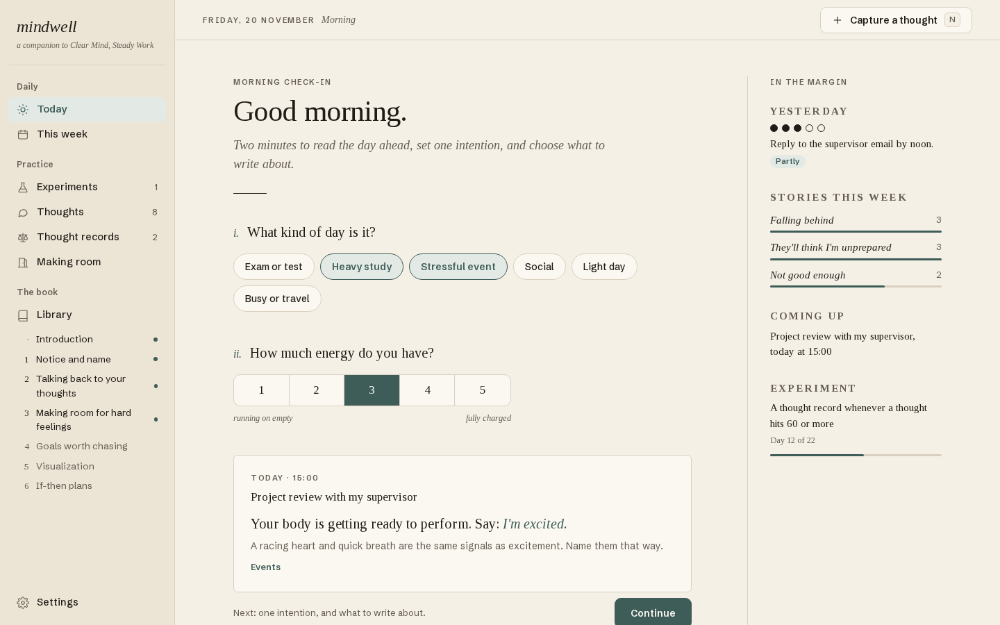
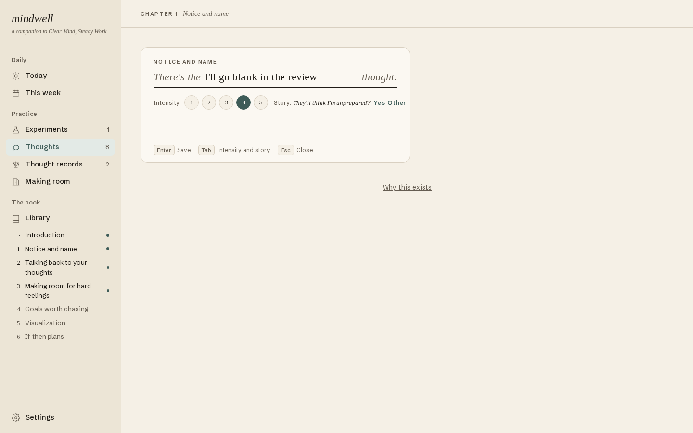
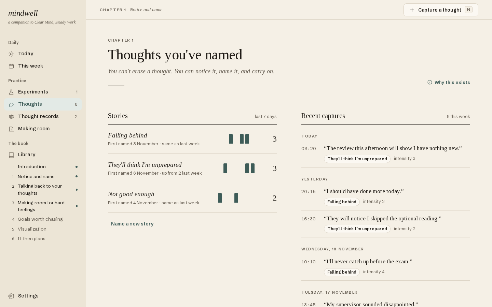
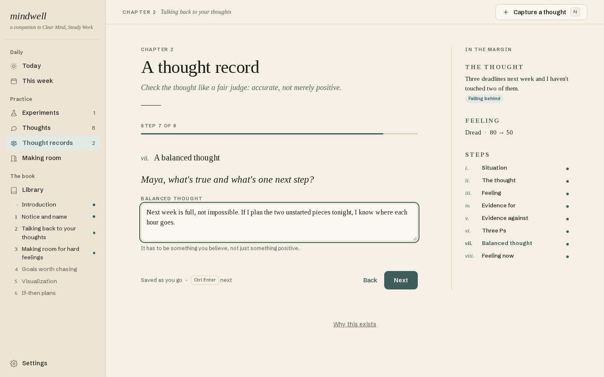
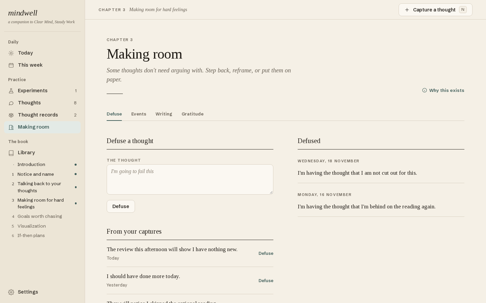
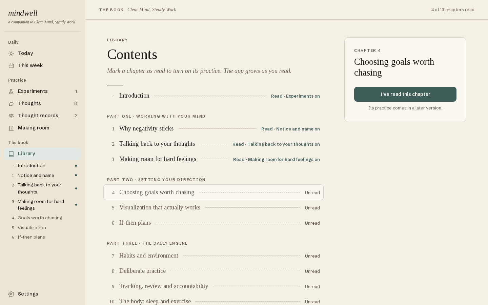
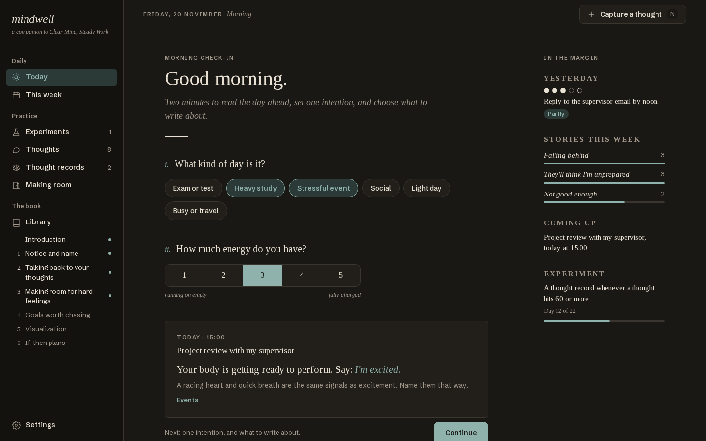

# mindwell

A companion web app to the book *Clear Mind, Steady Work*. It sets the day's intent, picks what to write about, and keeps a record of what works for you.

Live app: https://aaraadhyahaha.github.io/mindwell/



All data in the screenshots is made-up demo data.

## What it is and why

mindwell is an evidence ledger, not a motivation source. Motivation fades within days. A record of your own thoughts, experiments and kept intentions gets more useful every month. After a few months it can show which negative stories keep returning, how much a thought record usually lowers your distress, and which techniques worked for you.

Six principles guide every feature:

1. Evidence over motivation. No quotes, badges, confetti or streak fireworks.
2. Every feature traces to a chapter of the book.
3. Every practice is an experiment: try it for a set time, then keep or drop it.
4. The app suggests. You decide.
5. Kind about slips. A missed day is information, not a failure.
6. Partner to the paper journal. Free writing stays in your notebook. The app keeps ratings, captured thoughts, thought records, intents and verdicts.

Each chapter is a module. It unlocks when you mark the chapter read in the Library.

## Features by chapter

### Introduction: experiments

Start an experiment on any technique from an unlocked chapter: a hypothesis, a length (21 days by default), a weekly "Is this helping?" rating. At the end, keep, drop or extend. Up to three run at once. A running experiment shows in the Today margin (see the screenshot above).

### Chapter 1: Notice and name

Capture a thought in a few seconds: "There's the ___ thought." Add an intensity from 1 to 5. The app suggests a recurring story to link it to, and never links without your yes.



Thoughts shows your named stories, how often each came up this week, and your recent captures.



### Chapter 2: Talking back to your thoughts

A thought record in eight steps: situation, the thought, the feeling, evidence for and against, a three-Ps check, a balanced thought, and how you feel now. It autosaves. Start it from a capture and the thought is filled in.



### Chapter 3: Making room for hard feelings

Four tabs: defuse a thought ("I'm having the thought that..."), plan for stressful events with an "I'm excited" reframe and reminders, run a 3 or 4 day expressive writing series with a timer, and note gratitude. The writing happens on paper. The app stores only that it happened.



### Library

Mark a chapter read to turn on its practice. Chapters without a module yet say so.



### Night theme

Light, dark or system, set in Settings.



## The daily loop

1. Morning check-in. Day type and energy. Under three minutes.
2. One intent, and up to three journal prompts. Write in your paper journal, then mark each prompt useful or not.
3. Capture thoughts during the day.
4. Evening close. Was the intent kept? Rate the day. One optional reflection.
5. Weekly review. Look at the week, accept or dismiss suggestions, rate your experiments.

## Privacy and backups

- All data stays in your browser, in a SQLite database in the origin-private file system.
- Nothing is sent anywhere. There are no accounts.
- Settings, Export: JSON or Markdown file download.
- Settings, Restore from backup: import a JSON export. It shows a summary and asks before replacing anything.
- Data is per browser and per site address. To move from `localhost` to the hosted app, export on one and restore on the other.

Desktop capture shortcut: bind a key in your desktop or window manager to open `https://aaraadhyahaha.github.io/mindwell/#capture`. Settings shows the exact line for your setup. Inside the app, press `N`.

## Tech stack and architecture

- SvelteKit (static SPA) with Svelte 5, TypeScript (strict)
- SQLite WASM (opfs-sahpool) in a Web Worker
- PWA through the SvelteKit service worker
- pnpm workspaces, Vitest

Packages:

- `packages/core`: plain TypeScript. Records, the Store interface, prompt engine, signals.
- `packages/storage-sqlite`: the Store over SQLite, plus the browser driver.
- `packages/ui`: design system and bundled fonts.
- `packages/modules/*`: one package per chapter module.
- `apps/web`: the app shell.

Modules never import each other. They share data only through core records and published signals. See [docs/ARCHITECTURE.md](docs/ARCHITECTURE.md) and [docs/MODULE_CONTRACT.md](docs/MODULE_CONTRACT.md).

## Local development

Needs Node 22 or newer and pnpm.

```sh
pnpm install
pnpm dev       # http://localhost:5173
pnpm test      # unit tests
pnpm check     # type and Svelte checks
pnpm build     # static files in apps/web/build/
pnpm preview   # http://localhost:4173/mindwell/
```

To regenerate the screenshots:

```sh
pnpm exec playwright install chromium
pnpm build && node scripts/screenshots.mjs
```

## Deploying

`.github/workflows/deploy.yml` runs on every push to `main`. It runs check, test and build with the base path `/mindwell` (set by `BASE_PATH`), then deploys to GitHub Pages. In the repo, set Settings, Pages, Source to GitHub Actions.

For a fork under a different repo name, set `BASE_PATH` to `/<repo-name>`.

## Roadmap

Chapters 0 to 3 are built. Next, one module per chapter:

- 4. Choosing goals worth chasing: a goal sheet with subgoals and a quarterly revisit.
- 5. Visualization that actually works: weekly WOOP and a one-minute rehearsal card.
- 6. If-then plans: plans as reminders at the cue.
- 7. Habits and environment: fixed cue, minimum version, friction checklist.
- 8. Deliberate practice: weak spots, self-testing, spacing.
- 9. Tracking, review and accountability: daily tick chart and the full weekly review.
- 10. The body: sleep and exercise: a log, and a "tired?" check before late-night thought records.
- 11. Setbacks and self-compassion: a slip flow, never miss twice, fresh-start dates.
- 12. Confidence you can trust: wins, confidence ladders, and the evidence ledger across all modules.

Designed for, not built: a phone companion, sync, importers, app lock and encryption.

## Credits and licenses

The practices come from the book *Clear Mind, Steady Work*. This app is a companion to it, not a replacement.

Code is under the MIT license. See [LICENSE](LICENSE).

Fonts in `packages/ui/src/fonts/`:

- Tinos: SIL Open Font License 1.1 ([Tinos-OFL.txt](packages/ui/src/fonts/Tinos-OFL.txt)).
- Schibsted Grotesk: SIL Open Font License 1.1 ([SchibstedGrotesk-OFL.txt](packages/ui/src/fonts/SchibstedGrotesk-OFL.txt)).

Contributors and Claude Code: see [CLAUDE.md](CLAUDE.md).
